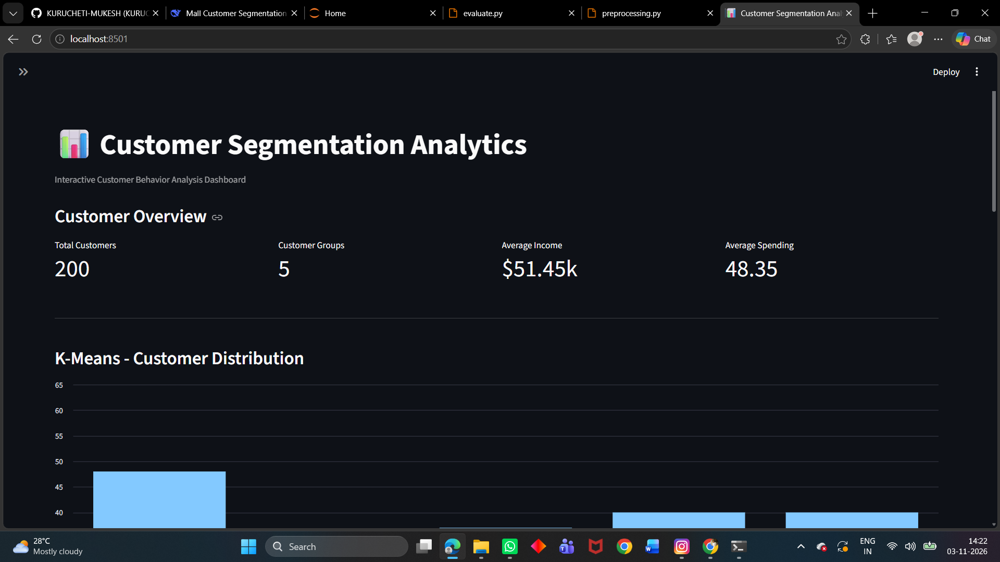

# Customer Segmentation using Unsupervised Machine Learning

A complete, end-to-end **unsupervised machine learning** project that segments mall customers
into actionable marketing groups using **K-Means**, **DBSCAN**, and **Hierarchical
(Agglomerative) Clustering** — with the Elbow Method, Silhouette Score, and business-insight
generation.


---

## Table of Contents

- [Project Overview](#project-overview)
- [Dataset](#dataset)
- [Features](#features)
- [Project Structure](#project-structure)
- [Tech Stack](#tech-stack)
- [Installation](#installation)
- [Run the Project](#run-the-project)
- [Dashboard Guide](#dashboard-guide)
- [Methodology](#methodology)
- [Model Evaluation Results](#model-evaluation-results)
- [Business Insights](#business-insights)
- [Generated Outputs](#generated-outputs)
- [Screenshots](#screenshots)
- [Limitations](#limitations)
- [Future Improvements](#future-improvements)
- [License and Attribution](#license-and-attribution)

---

## Project Overview

Retail businesses can use customer attributes such as age, annual
income, and spending score to understand different customer groups. This
project applies **unsupervised machine learning** to group customers
based on these characteristics and presents the results through an
interactive analytics dashboard.

The project compares: 1. **K-Means** 2. **DBSCAN** 3. **Hierarchical
(Agglomerative) Clustering**

## Dataset

The dataset contains: - `CustomerID` - `Gender` - `Age` -
`Annual Income (k$)` - `Spending Score (1-100)`

The bundled `data/mall_customers.csv` is a **synthetically generated
dataset** designed to resemble the structure and value ranges of the
Mall Customer Segmentation dataset. It contains approximately 200
records. It is not actual mall transaction or customer data.

For experiments with the original dataset, download it from [Kaggle --
Customer Segmentation Tutorial in
Python](https://www.kaggle.com/datasets/vjchoudhary7/customer-segmentation-tutorial-in-python)
and replace `data/mall_customers.csv`, keeping the same column names.

## Features

### Machine Learning

- Data quality checks, missing-value handling, and duplicate removal.
- Categorical encoding and feature scaling.
- K-Means, DBSCAN, and Hierarchical clustering.
- Evaluation using Silhouette Score, Davies-Bouldin Index, and
  Calinski-Harabasz Score.
- Cluster summaries, charts, and business-insight generation.

### Interactive Streamlit Dashboard

- Select K-Means, DBSCAN, or Hierarchical clustering.
- Filter customers by gender, age, annual income, and spending score.
- Search by Customer ID and view individual customer details.
- View customer distribution and interactive cluster visualizations.
- Compare average age, income, and spending across clusters.
- Review customer segment descriptions and recommendations.
- Download filtered customer data as CSV.
- Download a text business report based on the current selection and
  filters.

## Project Structure

```text
customer-segmentation-clustering/
├── dashboard/
│   └── app.py                         # Interactive Streamlit dashboard
├── data/
│   ├── mall_customers.csv             # Raw input dataset
│   ├── mall_customers_clean.csv       # Cleaned dataset (generated)
│   └── mall_customers_clustered.csv   # Clustered dataset (generated)
├── notebooks/
│   └── project.ipynb                  # Project walkthrough notebook
├── src/
│   ├── preprocessing.py               # Cleaning and preprocessing
│   ├── train.py                       # Clustering model training
│   ├── evaluate.py                    # Evaluation, summaries, and insights
│   └── utils.py                       # Shared paths and helper functions
├── reports/
│   ├── project_report.md
│   ├── algorithm_comparison.csv       # Generated evaluation results
│   ├── customer_segment_summary.csv   # Generated cluster summary
│   └── business_insights.csv          # Generated business insights
├── images/                            # Generated charts
├── requirements.txt
├── README.md
├── LICENSE
└── .gitignore
```

## Tech Stack

- **Language:** Python 3.10+
- **Data processing:** pandas, NumPy
- **Machine learning:** scikit-learn
- **Visualization:** Matplotlib, Seaborn, Plotly
- **Dashboard:** Streamlit
- **Notebook:** Jupyter
- **Version control:** Git and GitHub

## Installation

### 1. Clone the repository

```bash
# 1. Clone the repository
git clone https://github.com/KURUCHEI-MUKESH/customer-segmentation-clustering.git
cd customer-segmentation-clustering
```

### 2. Create and activate a virtual environment

**Windows PowerShell:**

```powershell
python -m venv venv
.\venv\Scripts\Activate.ps1
```

**macOS / Linux:**

```bash
python -m venv venv
source venv/bin/activate
```

### 3. Install dependencies

```bash
pip install -r requirements.txt
```

If Streamlit and Plotly are not already listed in `requirements.txt`,
install them and add both package names to that file:

```bash
pip install streamlit plotly
```

## Run the Project

Run commands from the project root directory.

### Option A: Run the machine learning pipeline

```bash
python src/preprocessing.py
python src/train.py
python src/evaluate.py
```

Run these scripts in order: training uses the cleaned data, and
evaluation uses the clustered output.

### Option B: Launch the dashboard

After generating the cleaned and clustered data and evaluation reports:

```bash
streamlit run dashboard/app.py
```

Open the local URL printed by Streamlit, usually
`http://localhost:8501`.

### Option C: Explore the notebook

```bash
jupyter notebook notebooks/project.ipynb
```

## Dashboard Guide

1.  **Algorithm selection:** Choose K-Means, DBSCAN, or Hierarchical
    clustering. The dashboard uses the corresponding cluster-label
    column.
2.  **Customer filters:** Filter by gender, age range, annual income
    range, and spending score. Metrics, charts, summaries, and downloads
    reflect the selected filters.
3.  **Customer search:** Select a Customer ID to view age, gender,
    annual income, spending score, and cluster assignment. Search
    results are limited to the currently filtered data.
4.  **Visual analysis:** Explore customer distribution,
    income-versus-spending clusters, and average age, income, and
    spending by cluster.
5.  **Insights and downloads:** Review segment descriptions and
    recommendations. Download filtered customer data as CSV or generate
    a text business report for the current selection.

## Methodology

1.  **Preprocessing:** Check data quality, handle missing values, remove
    duplicates, encode categorical data, and scale numerical features.
2.  **Exploratory analysis:** Review distributions and relationships
    among customer attributes.
3.  **Clustering:** Train K-Means, DBSCAN, and Agglomerative clustering
    models.
4.  **Evaluation:** Compare clustering quality using Silhouette Score,
    Davies-Bouldin Index, and Calinski-Harabasz Score.
5.  **Interpretation:** Summarize cluster characteristics and create
    rule-based business recommendations.
6.  **Dashboarding:** Present model outputs in an interactive Streamlit
    application.

## Model Evaluation Results

The evaluation output shared for the bundled dataset was:

---

Algorithm Clusters Silhouette Davies-Bouldin Calinski-Harabasz
Score Index Score

---

K-Means 5 0.4564 0.8265 232.8590

DBSCAN 3 0.4323 0.7669 157.9825

Hierarchical 5 0.4396 0.8630 221.7038

---

A higher Silhouette Score and Calinski-Harabasz Score are generally
preferred; a lower Davies-Bouldin Index is generally preferred. K-Means
has the highest Silhouette and Calinski-Harabasz scores in these
results, while DBSCAN has the lowest Davies-Bouldin Index. No single
algorithm leads on all three metrics. Results can vary with the dataset,
preprocessing, and model parameters.

## Business Insights

The project translates cluster averages into understandable customer
profiles, such as: - Premium or high-value customers. - High-income
customers with lower spending scores. - Budget-conscious customers with
higher spending scores. - Lower-engagement customers. - Average
customers.

**Important:** Segment labels and recommendations are rule-based
interpretations, not labels learned by the clustering algorithms. The
interactive dashboard compares cluster averages with the median income
and spending score of the currently filtered customer data. Segment
names can therefore change when filters or the selected algorithm
change. Recommendations are exploratory ideas, not proven marketing
outcomes.

## Generated Outputs

Depending on which scripts and dashboard actions are run, outputs
include: - `data/mall_customers_clean.csv` -
`data/mall_customers_clustered.csv` -
`reports/algorithm_comparison.csv` -
`reports/customer_segment_summary.csv` -
`reports/business_insights.csv` - Generated charts under `images/` -
Customer CSV and business report downloaded from the dashboard

## Screenshots

Add screenshots of your running dashboard to this section before
publishing the repository. Suggested screenshots: 1. Dashboard overview
with sidebar filters. 2. Customer distribution and cluster
visualization. 3. Customer profile analysis charts. 4. Customer segment
insights and recommendations. 5. Customer search and download controls.

After saving screenshots in the repository, add links using their actual
paths. For example:

```markdown

```

## Limitations

- The bundled data is synthetic and must not be presented as real
  customer data.
- The dataset contains basic customer attributes, not actual purchase
  histories or campaign outcomes.
- Business recommendations are heuristic interpretations and have not
  been validated through real marketing experiments.
- Clustering results depend on selected features, scaling, model
  parameters, and input data.

## Future Improvements

- Add PCA-based dimensionality reduction for additional cluster
  visualization.
- Evaluate models on a larger real-world customer dataset where
  permitted.
- Add model parameter controls and more detailed cluster validation.
- Save and load trained models for repeatable predictions on new
  customer records.
- Track segment changes over time when longitudinal data becomes
  available.
- Validate marketing recommendations using real campaign results or
  controlled experiments.

## Author

**Kurucheti Mukesh**\
B.Tech -- Artificial Intelligence and Data Science

- **LinkedIn:**
  [linkedin.com/in/kuruchetimukesh](https://linkedin.com/in/kuruchetimukesh)
- **GitHub:** Add your GitHub profile URL here.

This version includes additional work by Kurucheti Mukesh, including the
interactive Streamlit dashboard, customer filters and search, profile
visualizations, segment insights, and downloadable reports.

## License and Original Project Attribution

This project is based on the original customer segmentation project by
**Shubh**. The original project's MIT license and attribution are
retained. See [`LICENSE`](LICENSE) for the full license text.

If you reuse or redistribute this project, keep the original license and
attribution notices. The additions described above are contributions
made in this version.
