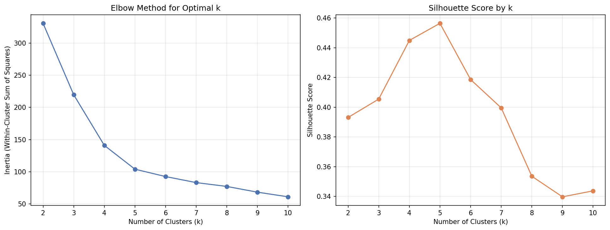
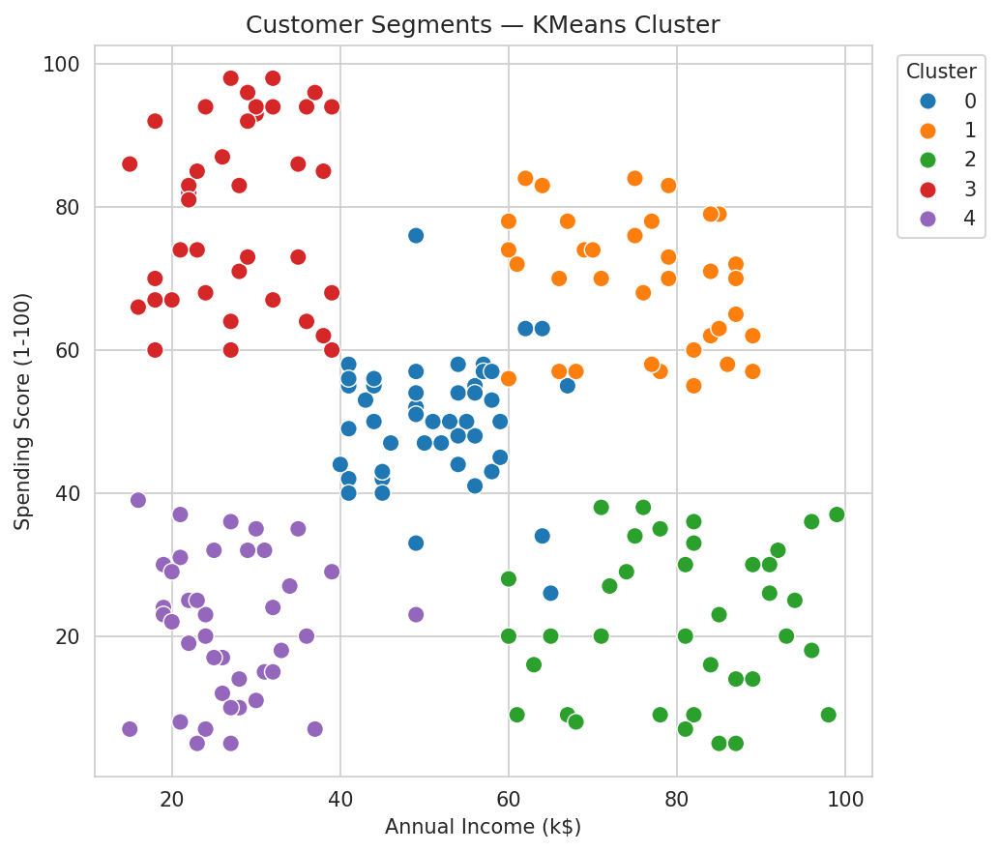
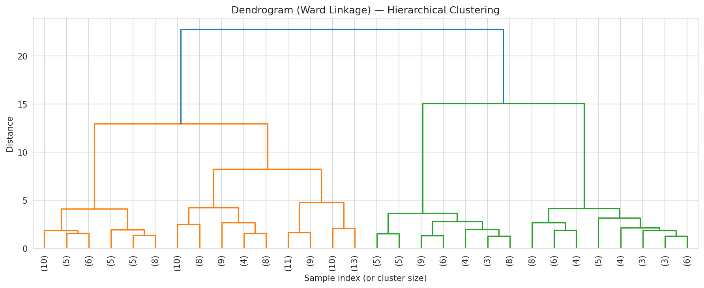
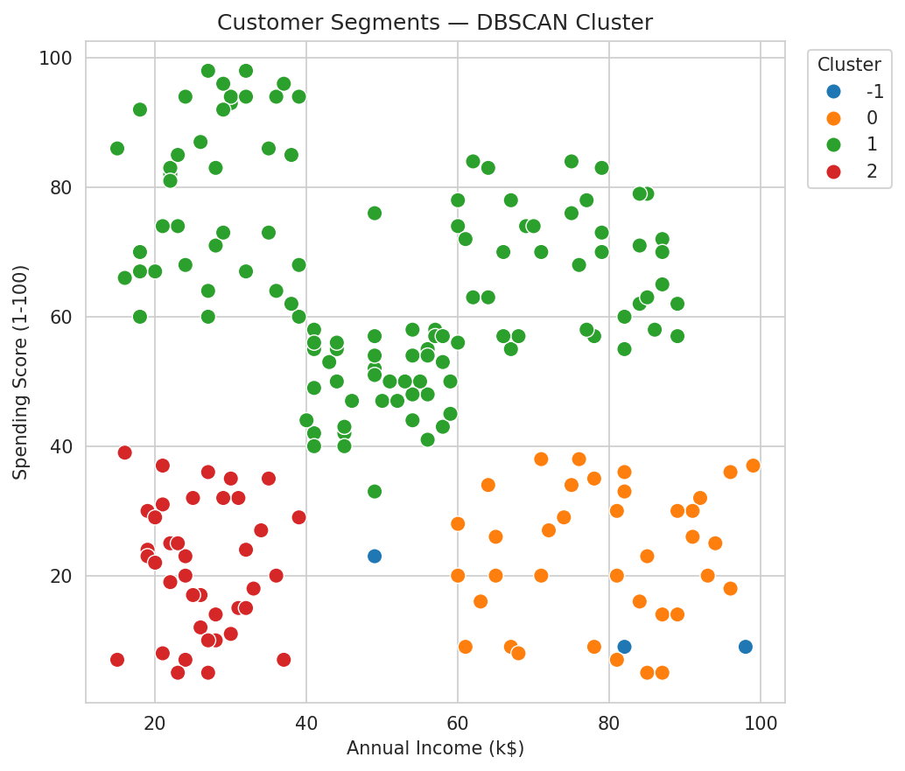
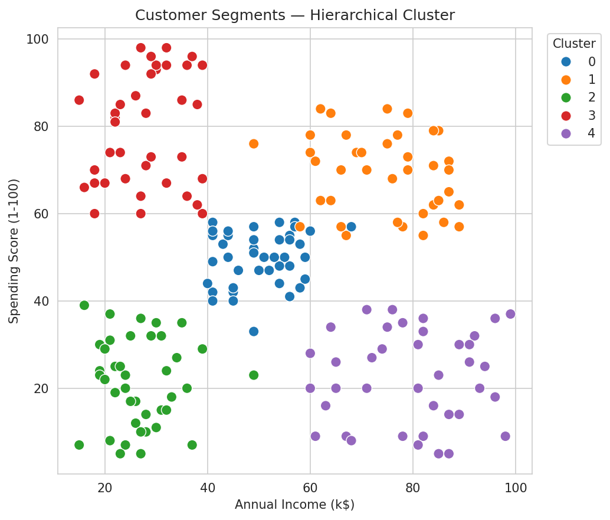
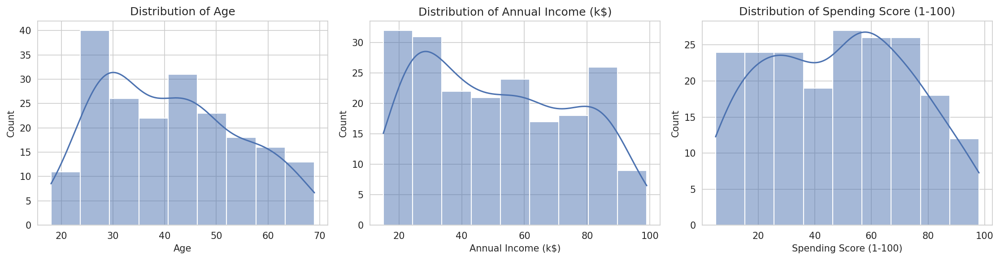
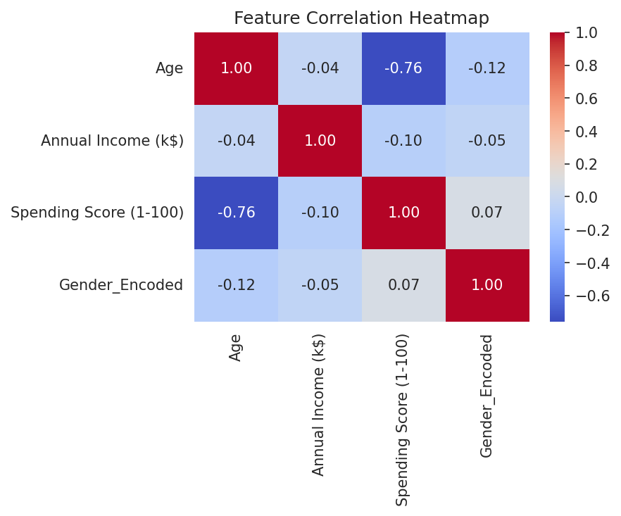

# 🛍️ Customer Segmentation using Unsupervised Machine Learning

A complete, end-to-end **unsupervised machine learning** project that segments mall customers
into actionable marketing groups using **K-Means**, **DBSCAN**, and **Hierarchical
(Agglomerative) Clustering** — with the Elbow Method, Silhouette Score, and business-insight
generation.


---

## 📌 Table of Contents

- [Project Overview](#-project-overview)
- [Dataset](#-dataset)
- [Folder Structure](#-folder-structure)
- [Installation](#-installation)
- [Usage](#-usage)
- [Methodology](#-methodology)
- [Results](#-results)
- [Business Insights](#-business-insights)
- [Screenshots](#-screenshots)
- [Tech Stack](#-tech-stack)
- [Future Improvements](#-future-improvements)
- [License](#-license)

---

## 🎯 Project Overview

Retail businesses collect basic customer attributes — age, income, spending habits — but
rarely convert that raw data into a strategy. This project applies **unsupervised learning**
to group ~200 mall customers into distinct behavioural segments **without any labeled data**,
then translates each cluster into a concrete marketing action.

**Why unsupervised learning?** There is no "correct" segment label to train against — the
whole point is to *discover* natural groupings in customer behaviour. This makes clustering
the right tool for the job, and a great demonstration of unsupervised ML for a minor project.

**What this project demonstrates:**
- A full, reproducible ML pipeline: raw data → cleaning → EDA → modeling → evaluation → insight.
- Three different clustering algorithms trained and rigorously compared, not just one.
- Data-driven model selection using the **Elbow Method** and **Silhouette Score**, rather than
  an arbitrarily chosen number of clusters.
- Translation of unsupervised model output into **plain-language business recommendations** —
  the part most student projects skip.

---

## 📊 Dataset

This project is built around the structure of the well-known **Mall Customer Segmentation
Dataset**:

- **Kaggle:** [Customer Segmentation Tutorial in Python](https://www.kaggle.com/datasets/vjchoudhary7/customer-segmentation-tutorial-in-python)
- **Columns:** `CustomerID`, `Gender`, `Age`, `Annual Income (k$)`, `Spending Score (1-100)`
- **Size:** 200 customer records

> ⚠️ **Important note on the bundled data file:** `data/mall_customers.csv` in this repo is a
> **synthetically generated dataset** built to statistically mirror the real Mall Customer
> dataset's structure, value ranges, and cluster patterns (it even includes a few injected
> missing values and duplicate rows so the preprocessing pipeline has real problems to solve).
> It was generated this way because the original file requires a Kaggle account/API key to
> download programmatically.
>
> **To reproduce results on the original data:** download `Mall_Customers.csv` from the Kaggle
> link above and replace `data/mall_customers.csv` with it (keeping the same column names). All
> code in `src/` and `notebooks/project.ipynb` will work unchanged, since it references columns
> by name, not by exact values.

---

## 📁 Folder Structure

```
project/
├── data/
│   ├── mall_customers.csv              # Raw input dataset
│   ├── mall_customers_clean.csv        # After preprocessing (generated)
│   └── mall_customers_clustered.csv    # Final output with cluster labels (generated)
├── notebooks/
│   └── project.ipynb                   # Full walkthrough notebook (EDA -> models -> insights)
├── src/
│   ├── preprocessing.py                # Cleaning, encoding, scaling pipeline
│   ├── train.py                        # K-Means / DBSCAN / Hierarchical training + elbow/silhouette
│   ├── evaluate.py                     # Metric comparison, plots, business-insight generation
│   └── utils.py                        # Shared paths, logging, plot-saving helpers
├── reports/
│   └── project_report.md               # Detailed written report (methodology, results, insights)
├── images/                              # All generated charts (EDA, elbow, cluster scatter plots, dendrogram)
├── requirements.txt
├── README.md
├── LICENSE
└── .gitignore
```

---

## ⚙️ Installation

```bash
# 1. Clone the repository
git clone https://github.com/<your-username>/customer-segmentation-clustering.git
cd customer-segmentation-clustering

# 2. (Recommended) create a virtual environment
python -m venv venv
source venv/bin/activate        # On Windows: venv\Scripts\activate

# 3. Install dependencies
pip install -r requirements.txt
```

---

## 🚀 Usage

### Option A — Run the notebook (recommended for exploring the project)

```bash
jupyter notebook notebooks/project.ipynb
```

The notebook walks through every step — loading, cleaning, EDA, elbow/silhouette analysis,
all three clustering models, evaluation, and business insights — with all plots rendered
inline.

### Option B — Run the modular pipeline from the command line

```bash
# Step 1: Clean the raw data -> data/mall_customers_clean.csv
python src/preprocessing.py

# Step 2: Train K-Means, DBSCAN & Hierarchical models, run elbow/silhouette analysis
#          -> data/mall_customers_clustered.csv, images/elbow_and_silhouette.png
python src/train.py

# Step 3: Evaluate & compare all 3 algorithms, generate cluster plots + insights
python src/evaluate.py
```

Each script can also be imported as a module, e.g.:

```python
from src.preprocessing import run_preprocessing_pipeline
from src.train import run_training_pipeline
from src.evaluate import compare_algorithms, generate_business_insights

df = run_training_pipeline(optimal_k=5)
```

---

## 🔬 Methodology

1. **Preprocessing** — median imputation for missing values, duplicate removal, label
   encoding for `Gender`, and `StandardScaler` normalization for `Age`, `Annual Income (k$)`,
   and `Spending Score (1-100)`.
2. **EDA** — distribution plots, gender breakdown, correlation heatmap, and pairwise
   scatter plots to understand feature relationships before modeling.
3. **Optimal cluster count** — computed inertia and silhouette score for `k = 2` to `10`
   using K-Means; selected **k = 5** based on the elbow bend and the silhouette peak.
4. **Modeling** — trained three algorithms on the scaled features:
   - **K-Means** (`k=5`, `k-means++` init)
   - **DBSCAN** (`eps=0.6`, `min_samples=5`)
   - **Agglomerative / Hierarchical Clustering** (`n_clusters=5`, Ward linkage)
5. **Evaluation** — compared all three using **Silhouette Score** (higher = better
   separated) and **Davies-Bouldin Index** (lower = more compact/separated clusters).
6. **Business translation** — grouped cluster centroids by average income/spending
   behaviour into 5 human-readable customer personas with recommended marketing actions.

---

## 📈 Results

| Algorithm | Clusters Found | Silhouette Score ↑ | Davies-Bouldin Index ↓ |
|---|---|---|---|
| **K-Means** | 5 | **0.456** | 0.827 |
| DBSCAN | 3 (+ noise) | 0.432 | **0.767** |
| Hierarchical | 5 | 0.440 | 0.863 |

**K-Means was selected as the final model** — it produced the best silhouette score, assigns
*every* customer to a segment (unlike DBSCAN, which leaves outliers unclustered), and its
segments align closely with intuitive, actionable customer personas.

> Exact numbers will vary slightly depending on the dataset used (synthetic vs. original
> Kaggle file) and random seed, but the qualitative pattern — K-Means and Hierarchical
> converging on ~5 well-separated segments, with DBSCAN better suited to outlier detection —
> is consistent.

---

## 💡 Business Insights

| Segment | Profile | Recommended Action |
|---|---|---|
| **Premium / High-Value Customers** | Moderate–high income, high spending score | Loyalty programs, premium product launches |
| **High Income, Cautious Spenders** | High income, low spending score | Personalized, trust-building offers — largest untapped revenue |
| **Budget-Conscious Big Spenders** | Lower income, high spending score, younger | Installment plans, value bundles |
| **Low Engagement Customers** | Low income, low spending score, older | Discount-led re-engagement / win-back campaigns |
| **Standard / Average Customers** | Mid income, mid spending score | Steady seasonal promotions |

Full statistics per cluster (average age, income, spending score, and customer count) are
generated automatically by `src/evaluate.py` and walked through in `notebooks/project.ipynb`.
See `reports/project_report.md` for the full write-up.

---

## 🖼️ Screenshots

**Elbow Method & Silhouette Score — choosing k**



**Final Customer Segments — K-Means (k=5)**



**Hierarchical Clustering Dendrogram**



**Algorithm Comparison — DBSCAN vs. Hierarchical**

<table>
<tr>
<td></td>
<td></td>
</tr>
</table>

**Exploratory Data Analysis**




*(All charts above are generated automatically by the pipeline and saved into `images/`.)*

---

## 🛠️ Tech Stack

- **Language:** Python 3.10+
- **Data handling:** pandas, numpy
- **Visualization:** matplotlib, seaborn
- **Machine Learning:** scikit-learn (`KMeans`, `DBSCAN`, `AgglomerativeClustering`,
  `StandardScaler`, `silhouette_score`, `davies_bouldin_score`)
- **Hierarchical tools:** scipy (`linkage`, `dendrogram`)
- **Notebook:** Jupyter

---

## 🔮 Future Improvements

- Add **PCA** for 2D/3D visualization when more features are available.
- Deploy the trained K-Means model behind a simple **Streamlit/Flask** dashboard for live
  customer scoring.
- Track **segment migration** over time as new transaction data arrives.
- Experiment with **Gaussian Mixture Models** for soft/probabilistic cluster assignment.
- A/B test the recommended marketing actions per segment against real campaign performance.

---

## 📄 License

This project is licensed under the [MIT License](LICENSE) — free to use, modify, and
distribute with attribution.

---

## 🙋 Author

**Shubh** — College Minor Project (Unsupervised Machine Learning)

If you found this project useful, consider ⭐ starring the repository!
