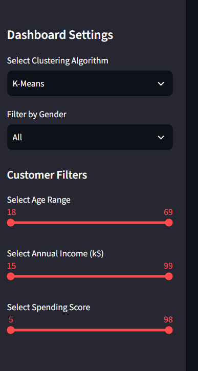
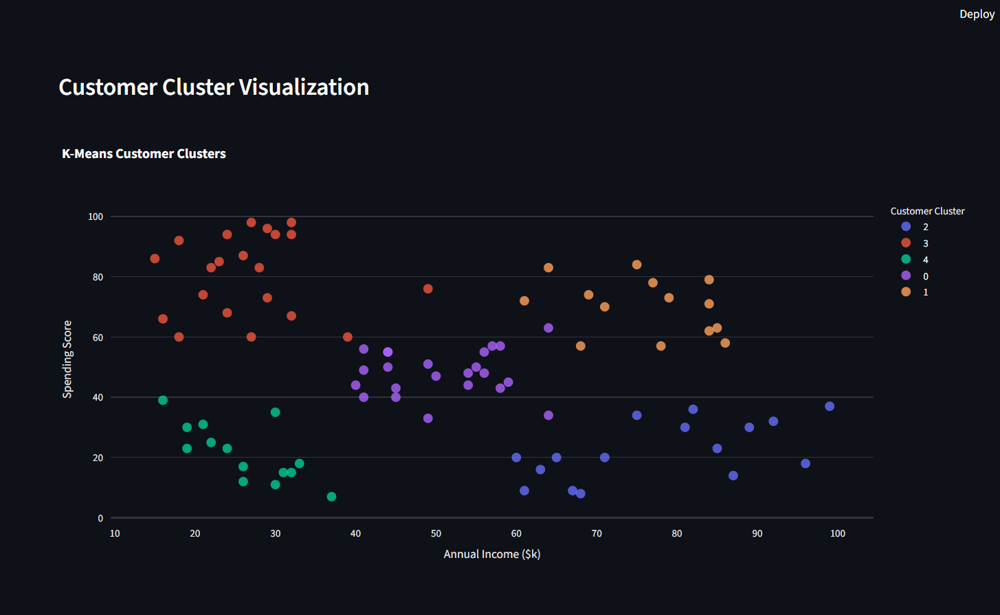
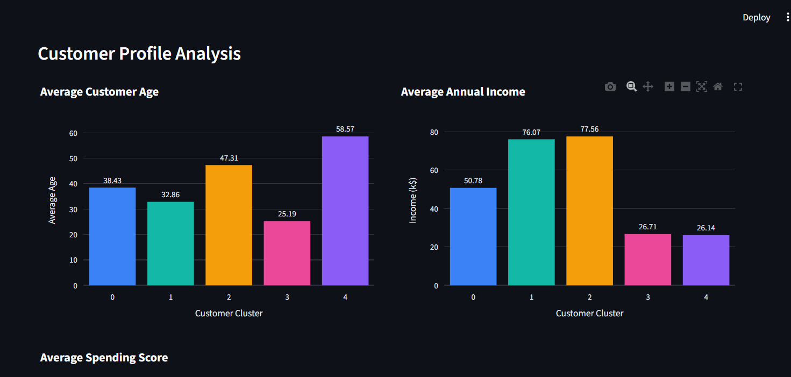
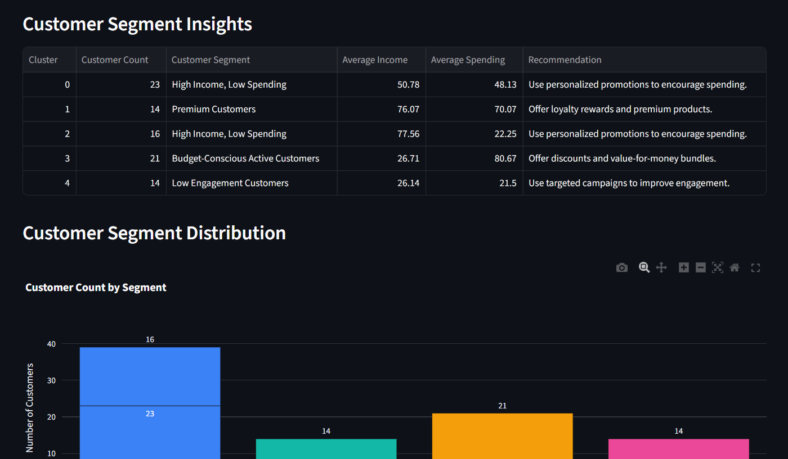

# Customer Segmentation Using Unsupervised Machine Learning

An end-to-end customer segmentation project using **K-Means, DBSCAN, and
Hierarchical (Agglomerative) Clustering**. This enhanced version
includes an interactive **Streamlit dashboard** to explore customer
groups, compare model results, view business insights, and download
reports.


------------------------------------------------------------------------

## Table of Contents

-   [Project Overview](#project-overview)
-   [Features](#features)
-   [Dataset](#dataset)
-   [Project Structure](#project-structure)
-   [Technology Stack](#technology-stack)
-   [Installation](#installation)
-   [How to Run](#how-to-run)
-   [Methodology](#methodology)
-   [Model Evaluation Results](#model-evaluation-results)
-   [Customer Segment Summary](#customer-segment-summary)
-   [Business Insights](#business-insights)
-   [Dashboard Screenshots](#dashboard-screenshots)
-   [Generated Outputs](#generated-outputs)
-   [Limitations](#limitations)
-   [Future Improvements](#future-improvements)
-   [Author and Contributions](#author-and-contributions)
-   [Original Project Attribution and
    License](#original-project-attribution-and-license)

------------------------------------------------------------------------

## Project Overview

Customer segmentation groups customers with similar characteristics so
businesses can better understand customer types and plan relevant
marketing strategies.

This project applies unsupervised machine learning to customer
attributes such as age, annual income, and spending score. It compares
three clustering algorithms and presents the results in an interactive
dashboard.

## Features

### Data Processing and Machine Learning

-   Data quality checks and preprocessing
-   Missing-value handling and duplicate removal
-   Categorical encoding and feature scaling
-   K-Means, DBSCAN, and Hierarchical clustering
-   Evaluation using Silhouette Score, Davies-Bouldin Index, and
    Calinski-Harabasz Score
-   Cluster summaries and rule-based business insights
-   Generated charts and CSV reports

### Interactive Streamlit Dashboard

-   Select K-Means, DBSCAN, or Hierarchical clustering
-   Filter customers by gender, age, annual income, and spending score
-   Search by Customer ID
-   View customer overview metrics
-   Explore cluster distribution and income-versus-spending
    visualizations
-   Compare average age, income, and spending across segments
-   Review segment insights and suggested actions
-   View segment counts and percentages
-   Compare model evaluation metrics
-   Download filtered customer data as CSV
-   Download a text-based business report

## Dataset

The bundled dataset contains **200 synthetic customer records** with
these fields:

  Column                     Description
  -------------------------- ---------------------------------------
  `CustomerID`               Customer identifier
  `Gender`                   Customer gender
  `Age`                      Customer age
  `Annual Income (k$)`       Annual income in thousands of dollars
  `Spending Score (1-100)`   Spending score on a scale of 1 to 100

**Important:** `data/mall_customers.csv` is synthetically generated to
resemble the structure and value patterns of a mall customer
segmentation dataset. It is not real customer transaction data and is
not the original Kaggle dataset. The original README references the
[Mall Customer Segmentation dataset on
Kaggle](https://www.kaggle.com/datasets/vjchoudhary7/customer-segmentation-tutorial-in-python)
as an optional alternative input source.

## Project Structure

``` text
customer-segmentation-clustering/
├── dashboard/
│   └── app.py                         # Interactive Streamlit dashboard
├── data/
│   ├── mall_customers.csv             # Bundled synthetic input data
│   ├── mall_customers_clean.csv       # Cleaned data (generated)
│   └── mall_customers_clustered.csv   # Clustered data (generated)
├── images/
│   ├── dashboard_overview.png
│   ├── customer_filters.png
│   ├── cluster_visualization.png
│   ├── customer_profile.png
│   ├── business_insights.png
│   ├── improved_kmeans_clusters.png
│   ├── improved_dbscan_clusters.png
│   └── improved_hierarchical_clusters.png
├── notebooks/
│   └── project.ipynb
├── reports/
│   ├── algorithm_comparison.csv
│   ├── business_insights.csv
│   ├── customer_segment_summary.csv
│   └── data_quality_report.csv
├── src/
│   ├── preprocessing.py
│   ├── train.py
│   ├── evaluate.py
│   └── utils.py
├── .gitignore
├── LICENSE
├── README.md
└── requirements.txt
```

Some CSV files and charts are generated when project scripts run. Your
local folder may contain additional files.

## Technology Stack

-   **Language:** Python
-   **Data handling:** pandas, NumPy
-   **Machine learning:** scikit-learn
-   **Visualization:** Matplotlib, Seaborn, Plotly
-   **Dashboard:** Streamlit
-   **Development:** Jupyter Notebook, VS Code, Git, GitHub

## Installation

### 1. Clone the repository

``` bash
git clone https://github.com/KURUCHETI-MUKESH/customer-segmentation-clustering.git
cd customer-segmentation-clustering
```

### 2. Create and activate a virtual environment

**Windows PowerShell:**

``` powershell
python -m venv venv
.\venv\Scripts\Activate.ps1
```

**macOS/Linux:**

``` bash
python -m venv venv
source venv/bin/activate
```

### 3. Install dependencies

``` bash
pip install -r requirements.txt
```

The requirements file should include `streamlit` and `plotly` along with
the project's data science and machine learning packages.

## How to Run

### Option A: Launch the Streamlit dashboard

From the project root directory:

``` bash
streamlit run dashboard/app.py
```

Open the local URL shown in the terminal.

### Option B: Run preprocessing and evaluation

``` bash
python src/preprocessing.py
python src/evaluate.py
```

The preprocessing script prepares the data. The evaluation script
generates model comparison results, cluster summaries, business
insights, and charts based on the available project outputs.

### Option C: Explore the notebook

``` bash
jupyter notebook notebooks/project.ipynb
```

## Methodology

1.  **Preprocessing:** Check data quality, handle missing values and
    duplicates, encode categorical data where required, and scale
    numerical features.
2.  **Clustering:** Apply K-Means, DBSCAN, and Hierarchical clustering
    to prepared customer data.
3.  **Evaluation:** Compare results using Silhouette Score,
    Davies-Bouldin Index, and Calinski-Harabasz Score.
4.  **Segment profiling:** Summarize customer counts and average age,
    income, and spending score for K-Means clusters.
5.  **Business interpretation:** Use rule-based descriptions to turn
    cluster profiles into example customer segments and suggested
    actions.
6.  **Dashboard:** Use Streamlit and Plotly to filter, explore, and
    download project results.

## Model Evaluation Results

Results recorded from the completed evaluation run:

  ---------------------------------------------------------------------------------
  Algorithm            Clusters     Silhouette   Davies-Bouldin   Calinski-Harabasz
                                         Score            Index               Score
  -------------- -------------- -------------- ---------------- -------------------
  K-Means                     5     **0.4564**           0.8265        **232.8590**

  DBSCAN                      3         0.4323       **0.7669**            157.9825

  Hierarchical                5         0.4396           0.8630            221.7038
  ---------------------------------------------------------------------------------

K-Means has the highest Silhouette Score and Calinski-Harabasz Score in
this run. DBSCAN has the lowest Davies-Bouldin Index. Different metrics
assess different aspects of clustering, so no algorithm is best across
every metric.

## Customer Segment Summary

Recorded K-Means cluster summary (200 customers):

  --------------------------------------------------------------------------
         Cluster Customer Count    Average Age Average Income        Average
                                                        (k\$) Spending Score
  -------------- -------------- -------------- -------------- --------------
               0             48          38.48          51.12          50.02

               1             35          32.63          75.71          69.34

               2             37          48.38          80.65          22.03

               3             40          26.20          28.28          79.42

               4             40          59.18          26.75          21.25
  --------------------------------------------------------------------------

## Business Insights

The project generates exploratory segment descriptions and marketing
suggestions from cluster profiles. Examples:

  -----------------------------------------------------------------------
  Example segment profile             Possible action
  ----------------------------------- -----------------------------------
  Higher income and higher spending   Consider loyalty programs and
                                      premium offers

  Higher income and lower spending    Test personalized offers and
                                      engagement campaigns

  Lower income and higher spending    Consider value bundles and
                                      affordable offers

  Lower income and lower spending     Test suitable re-engagement
                                      campaigns

  Middle-range income and spending    Consider seasonal promotions
  -----------------------------------------------------------------------

These are **rule-based suggestions**, not validated business findings.
They are based on the synthetic dataset and should be tested with real
customer and campaign data before business use.

## Dashboard Screenshots

### Dashboard overview


### Customer filters



### Cluster visualization



### Customer profile analysis



### Business insights



## Generated Outputs

-   `data/mall_customers_clean.csv` --- cleaned customer dataset
-   `data/mall_customers_clustered.csv` --- customer records with
    cluster labels
-   `reports/algorithm_comparison.csv` --- clustering algorithm metrics
-   `reports/customer_segment_summary.csv` --- customer counts and
    average cluster profiles
-   `reports/business_insights.csv` --- generated business insight
    descriptions
-   `reports/data_quality_report.csv` --- data quality summary
-   `images/` --- generated model charts and dashboard screenshots

## Limitations

-   The bundled dataset is synthetic and contains only 200 records.
-   Results may differ with another dataset or different model settings.
-   Clustering identifies patterns; it does not prove the groups are
    true customer types.
-   Business recommendations are rule-based examples and have not been
    tested against actual marketing outcomes.
-   This project is an analytical demonstration, not a production
    customer-targeting system.

## Future Improvements

-   Test the workflow on a larger, real, appropriately authorized
    customer dataset.
-   Add PCA-based cluster visualization.
-   Explore additional clustering methods such as Gaussian Mixture
    Models.
-   Track how customer segments change as new data becomes available.
-   Validate marketing recommendations using real campaign results.

## Author and Contributions

**Kurucheti Mukesh**\
B.Tech --- Artificial Intelligence and Data Science

-   **LinkedIn:**
    [linkedin.com/in/kuruchetimukesh](https://linkedin.com/in/kuruchetimukesh)
-   **GitHub:** [KURUCHETI-MUKESH](https://github.com/KURUCHETI-MUKESH)

Additional work in this version includes the interactive Streamlit
dashboard, customer filters and search, customer profile visualizations,
segment insights, model comparison display, and downloadable customer
data and reports.

## Original Project Attribution and License

This repository is based on the original customer segmentation project
by **Shubh**. The original MIT license and attribution are retained in
the [`LICENSE`](LICENSE) file. Preserve the original license and
attribution notices when reusing or redistributing original project
material.

The additional dashboard and documentation contributions described in
this README are by **Kurucheti Mukesh**.
